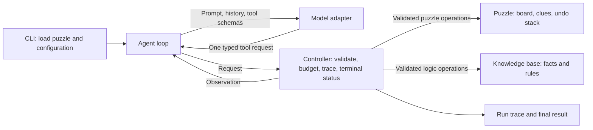

# Architecture specification

Status: initial design, written before implementation.

## Scope

Solve one valid 9-by-9 Sudoku puzzle per run using a bounded, sequential model/tool loop. Use Python and pytest. Provide a CLI, a recorded action-observation trace, and an independently validated submission. A graphical interface is outside the initial scope.

## Modules and ownership

| Planned module | Public interface | Owned state | Dependencies |
| --- | --- | --- | --- |
| `puzzle.py` | `Puzzle(board)`, `inspect(scope, row=None, col=None, box=None)`, `place(row, col, digit)`, `undo()`, `validate_solution()` | Original clues, current board, placement stack | Schemas' result helpers; standard library |
| `knowledge.py` | `KnowledgeBase()`, `add_fact(literal)`, `add_rule(premises, conclusion)`, `query(literal)` | Accepted facts and rules | Schemas' literal/result helpers; internal propositional satisfiability implementation |
| `schemas.py` | Tool schemas, `parse_request(raw)`, request/result types | No mutable session state | Standard library |
| `controller.py` | `Controller(board, max_actions)`, `step(raw_request)`, `snapshot()`, `fail_model()` | Puzzle and KB instances, action count, terminal status, trace | Puzzle, KB, schemas |
| `agent.py` | `run(controller, model)` | Temporary model conversation | Controller and model interface |
| `model.py` | `Model.next_request(messages, tool_schemas)` | Model runtime configuration | Runtime to be selected |
| `cli.py` | `main(argv)` | Run configuration and output paths | Agent, controller, model |

Methods that reject an operation return a structured result with an explicit error code. Invalid construction raises `ValueError`. Snapshots and public observations contain copies; callers cannot mutate owned state through them.

## Allowed interactions

Diagram text alternative: the CLI starts an agent loop. The loop asks a model adapter for one tool request and passes it to the controller. The controller alone dispatches puzzle and knowledge-base operations, records the observation, and controls termination. The observation returns to the loop for the next model turn.

The model receives prompts, tool schemas, and serialized action-observation history. It receives no references to the controller, puzzle, KB, filesystem, or terminal status setters. The adapter only generates requests; it cannot execute tools. The loop cannot declare a solution successful. Only the controller can accept a submission after puzzle validation.

## Model runtime decision

No external service is assumed. A local or server-backed runtime may implement the same model interface. Its output must be constrained to the tool schemas using the runtime's structured-output capability; controller validation remains mandatory. A runtime must demonstrate schema-constrained tool selection before it is selected for the final integration. The specific runtime and any dependency will be documented when verified.
