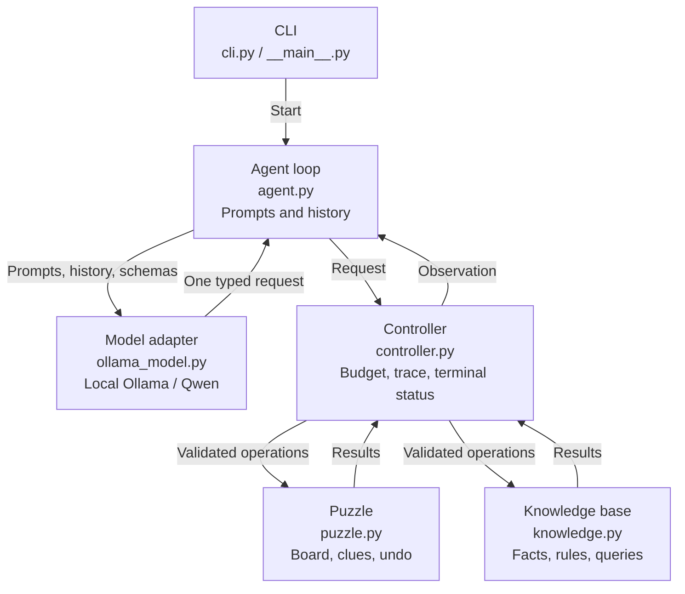

# Developing a ReAct Sudoku Agent

CS 4300-01 Artificial Intelligence  
Instructor: Curtis Larsen  
Date: October 20, 2026

## Git repository

[ReActSudokuAgent on GitHub](https://github.com/sshb4/ReActSudokuAgent)

## System structure and interactions

The program is a bounded ReAct agent for one valid 9-by-9 Sudoku puzzle. A local language model chooses one typed tool request at a time. The application owns the puzzle, knowledge base, action budget, trace, and terminal status. Model text cannot change state or declare success.

**Figure 1.** Requests pass through the controller before reaching puzzle or knowledge-base state. Observations return to the agent loop and model. `schemas.py` defines shared tool interfaces; `model.py` defines the runtime-independent model protocol.

**Diagram text alternative:** The CLI starts the agent loop. The loop sends prompts, history, and schemas to the local model adapter, which returns one tool request. The controller validates the request, enforces the action budget, records the trace, and dispatches puzzle or knowledge-base operations. Results return through the controller and loop to the model. The puzzle owns its board, clues, and undo history; the knowledge base owns its facts and rules.

## State boundaries and control

Original clues are immutable. Rejected requests cannot change puzzle or knowledge-base state. Undo removes the most recent accepted placement. Every attempted request consumes one action. A correct submission on the last allowed action succeeds; otherwise budget exhaustion terminates the run. Each observation reports an explicit terminal reason.

## Development process

### Specifications, tests, and coding-agent implementation

Architecture and public contracts were written before implementation. The contracts define tool schemas, board representation, propositional syntax and query semantics, undo behavior, controller policies, and ordered terminal checks. The main Git history records specifications, then tests, then implementation. Later revisions and their evidence are documented in `docs/development.md`.

Black-box tests were derived from these contracts before the corresponding main function bodies existed. The coding agent was provided the written specifications and corresponding tests and implemented a significant portion of the system. I reviewed the coding agent's changes against the contracts, ran the complete test suite, and revised the implementation when testing exposed mismatches. Tests cover success, rejection, invariant, boundary, and terminal behavior. Supplemental review added an independent truth-table oracle and explicitly labeled white-box fault injection.

### Revisions prompted by testing

The first real-model run repeatedly targeted a clue and ended at its action limit; the controller correctly protected the board. Board observations were revised to label empty-cell coordinates and provide legal candidates. A regex unsupported by the runtime was replaced without weakening controller validation. An assignment audit also identified missing terminal reasons in tool observations; regression tests were written before fixing that gap.

The small model needed clearer knowledge-base instructions. Runtime instructions were consolidated, and short developer reminders were derived from accepted observations. These reminders quote the model's own chosen proposition names to prevent transcription errors. They do not select coordinates, digits, or tool arguments, and they do not execute requests. Failed experiments remain separate from successful traces.

## Verification and limitations

The complete test suite passes **170 cases**. A genuine local run using Ollama 0.40.6 and Qwen 2.5 1.5B completed the example in **18 model-selected tool requests**, within a 24-action budget and with zero rejected requests. Its trace includes fact updates, rule updates, three entailed queries before placements, board observations, and explicit validated submission. A separate check preserved all clues and verified every row, column, and box.

The demonstration starts with three empty cells; it does not establish reliability on harder puzzles. Knowledge-base entailment is relative to model-asserted, uninterpreted propositions and does not certify their meaning about the board. Independent Sudoku validation remains essential. Undo is covered separately by public-behavior tests and a clearly labeled scripted replay.

## Takeaway I plan to keep

When developing, I plan to be more specific when deciding and writing down what each function should do before coding it, so I have a clear goal to implement and test.
